# kira-scan

**Zero-dependency static malware triage.** Point it at a file or a folder and get a scored verdict in milliseconds: hashes, entropy, PE structure, import-table capabilities, IOCs and signature rules. It also runs **your YARA rules** with its own engine, so the rule sets you already have (signature-base, your team's hunting rules) work on a box where nothing can be installed. Pure Python standard library.

[](https://github.com/njuj/kira-scan/actions/workflows/ci.yml)


<p align="center"></p>

<p align="center"></p>

```text
$ kira-scan notepad.exe mavinject.exe ClipUp.exe MRT.exe

 kira-scan v0.1.0  ·  4 file(s)  ·  10.67s

 • LOW         notepad.exe  score 5  ·  PE executable  ·  entropy 6.48
     └─ +5   Debugger detection checks — IsDebuggerPresent, OutputDebugString

 • LOW         mavinject.exe  score 35  ·  PE executable  ·  entropy 5.40
     ├─ +30  Remote process injection API chain — VirtualAllocEx, WriteProcessMemory, CreateRemoteThread
     └─ +5   Debugger detection checks — IsDebuggerPresent, NtQueryInformationProcess, OutputDebugString

 ⚠ SUSPICIOUS  ClipUp.exe  score 40  ·  PE executable  ·  entropy 7.28
     ├─ +15  High entropy — 7.28 bits/byte, likely packed or encrypted
     ├─ +20  High-entropy code section — .text (7.45)
     └─ +5   Debugger detection checks — IsDebuggerPresent, OutputDebugString

 ⚠ SUSPICIOUS  MRT.exe  score 45  ·  PE executable  ·  entropy 7.05
     ├─ +25  Embedded executable — 15 DOS stub(s) inside the file
     ├─ +5   Debugger detection checks — IsDebuggerPresent, OutputDebugString
     └─ +15  Autorun registry key (persistence) — \CurrentVersion\Run, \CurrentVersion\RunOnce

 0 clean  ·  2 low  ·  2 suspicious  ·  0 malicious
```

> These are real Windows binaries, and the output is correct. `mavinject.exe` really is an injector: it is a known LOLBin, [MITRE T1218.013](https://attack.mitre.org/techniques/T1218/013/). `ClipUp.exe` ships with an obfuscated `.text` section, and `MRT.exe` (Microsoft's own removal tool) carries 15 embedded PE images. None of them comes out *malicious*, because capability alone is not intent (see [scoring](#scoring)).

## What it looks at

| Layer | Signals |
|---|---|
| **Identity** | MD5 / SHA-1 / SHA-256 (streamed, any file size), magic-byte file type |
| **Entropy** | Shannon entropy of the whole file and of every PE section. Skipped for formats that are compressed by design (zip, png, 7z…) |
| **PE structure** | own bounds-checked parser: sections, `W+X` sections, packer section names (UPX, Themida, VMProtect, MPRESS…), high-entropy code, import **and** export tables |
| **Capabilities** | JSON signature rules matched against the **import table** for PEs (e.g. injection, hollowing, keylogging, anti-debug) and against raw content for scripts and documents (PowerShell cradles, ransom notes, shadow-copy deletion, infostealer paths, webhook exfil…) |
| **Deception** | double extensions (`invoice.pdf.exe`), right-to-left override in names, PE bytes hiding behind a `.jpg`, executables embedded inside other files |
| **IOCs** | URLs, IPv4, e-mails, registry keys, `.onion`, bech32 BTC, from ASCII **and** UTF-16LE strings |
| **YARA** *(opt-in)* | your `.yar` files, run by a YARA engine written in plain Python: text, hex and regex strings with their modifiers, the full condition language, and the `pe`, `math` and `hash` modules. Rules it cannot run are skipped and named, never guessed |
| **Intel** *(opt-in)* | VirusTotal v3 hash lookup. Only the SHA-256 leaves the machine, never the file |

## Install

```bash
pip install git+https://github.com/njuj/kira-scan
```

Or run it straight from a checkout, with nothing installed: `python -m kirascan <paths>`.

## Usage

```bash
kira-scan suspicious.exe                 # single file
kira-scan ~/Downloads -r                 # whole tree
kira-scan sample.bin -v                  # + hashes, PE sections, extracted IOCs
kira-scan samples/ -r --json > report.json
kira-scan drop.dll --rules my-rules/     # add your own rules
kira-scan samples/ -r --yara signature-base/yara/   # run a YARA rule set
VT_API_KEY=... kira-scan sample.exe --vt # reputation lookup
```

**Exit codes** are built for pipelines: `0` clean/low · `1` suspicious · `2` malicious · `3` error.

```bash
kira-scan build/artifacts -r --no-color || echo "release blocked: scanner verdict $?"
```

## Scoring

Each finding has a weight and a **kind**:

| kind | examples | why it matters |
|---|---|---|
| `anomaly` | packed sections, `W+X`, disguised extension, embedded PE, shadow-copy deletion | rare in legitimate software |
| `behavior` | injection APIs, keyboard hooks, autorun keys, anti-debug | common in legitimate software too (debuggers, shells, AV, accessibility tools) |
| `intel` | VirusTotal detections | someone else already looked |

Behavior weight is **capped at 60**, so capabilities alone can make a file *suspicious* but never *malicious*.

`0` clean · `1–39` low · `40–69` suspicious · `70–100` malicious

Two design decisions that came out of testing against a real `System32`:

* **API rules read the import table, minus re-exports.** A naive string match flags `kernel32.dll` as an injector, because it *exports* `VirtualAllocEx`. Matching only what a binary imports and does not re-export makes `kernel32.dll` come out clean. Matching is also name-boundary aware: `SetWindowsHookEx` matches `SetWindowsHookExW`, but `GetAsyncKeyState` does not match `NtUserGetAsyncKeyState`.
* **No "compile timestamp in the future" check.** Reproducible builds (`/Brepro`) store a content hash in that field, which is why `explorer.exe` claims it was compiled in 2102.

Result on 699 Windows 11 binaries (every `System32\*.exe` and `System32\k*.dll`, including `kernel32`, `kernelbase` and the keyboard-layout DLLs, plus `user32.dll` and `explorer.exe`): **0 malicious, 2 suspicious** (the two above). Most of the 10 s in the demo goes on `MRT.exe`, which is a 230 MB file; kira-scan analyses the first 32 MB by default and streams the hashes over the whole file.

## YARA rules, with nothing installed

```text
$ kira-scan mavinject.exe notepad.exe update.ps1 --yara examples/hunting.yar
kira-scan: 3 YARA rule(s) loaded from 1 file(s)

 ⚠ SUSPICIOUS  mavinject.exe  score 55  ·  PE executable  ·  entropy 5.40
     ├─ +30  Remote process injection API chain — VirtualAllocEx, WriteProcessMemory, CreateRemoteThread
     ├─ +5   Debugger detection checks — IsDebuggerPresent, NtQueryInformationProcess, OutputDebugString
     └─ +20  YARA rule LOLBin_AppV_Injector — signed App-V injector, loads a DLL into any process (T1218.013); $switch at 0x25930, $name at 0x31180

 • LOW         notepad.exe  score 5  ·  PE executable  ·  entropy 6.48
     └─ +5   Debugger detection checks — IsDebuggerPresent, OutputDebugString

 ✖ MALICIOUS   update.ps1  score 95  ·  text  ·  entropy 5.06
     ├─ +30  PowerShell download-and-execute pattern — DownloadString, Net.WebClient
     ├─ +5   URL that points straight at an IP address — https?://(?:\d{1,3}\.){3}\d{1,3}(?::\d+)?/
     └─ +60  YARA rule PowerShell_Download_Cradle — PowerShell that downloads code and runs it in memory; $dl1 at 0x1f, $run2 at 0x0
```

The real `yara64` 4.6 gives the same three matches at the same offsets on these files. A YARA hit counts in full, weighted by the rule's `meta: score` (70 when the rule has none): unlike a capability, it is somebody's deliberate detection. `filename`, `filepath`, `extension`, `filetype` and `owner` are filled in per file, so THOR-style rule sets such as [signature-base](https://github.com/Neo23x0/signature-base) load as they are.

**What it runs.** Text strings with `nocase`, `wide`, `ascii`, `fullword`, `xor` (with a key range), `base64`, `base64wide` and `private`; hex strings with wildcards, nibbles, `~`, jumps and alternatives; regular expressions, `wide` ones included. Conditions: `and`/`or`/`not`, arithmetic and bitwise operators, `N of them`, percentages, `$a at`/`in`, `#a`, `@a[i]`, `!a[i]`, `uint16be(…)`, `for … of` and `for … in` loops (over `pe.sections` too), string operators (`contains`, `iendswith`, `matches`…), rule references, `private` and `global` rules, and undefined values that behave as in YARA. Modules: `pe` (header fields, sections, `imports()` with names, ordinals or regexes, `exports()`, `imphash()`, overlay), `math` (`entropy`, `mean`, `deviation`…) and `hash` (`md5`, `sha1`, `sha256`, `crc32`).

**What it skips, out loud.** Authenticode signatures, resources and version info, other modules (`dotnet`, `elf`, `cuckoo`…), `include`, and the few regular expressions with a repeat inside a repeat that Python's engine could take forever on. Such a rule is left out with its reason (`-v` lists them all); the rest of the file still loads.

**How it was checked.**
- **Against the real YARA.** Every rule set in the test suite also runs through the real YARA in CI and must match it exactly. Building that check found three places where the first version disagreed with YARA, all fixed: `fullword` treats `_` as a word break; a comparison with an undefined value is undefined, so `not` of it stays false; and `pe.imports` refuses a regex and a plain string together.
- **On signature-base.** It loads 5,879 of the 5,910 rules in [signature-base](https://github.com/Neo23x0/signature-base) (99.5%). On 300 files (Windows binaries, tools and the rule files themselves, which trip many rules), it gave exactly the 143 matches that `yara64` 4.6 gives: none missed, none extra. The first run of this comparison is what caught `$a at 0 and $b` being read as `$a at (0 and $b)`.
- **Speed.** A 4-byte index of each file lets almost every string be ruled out with one set lookup, and strings are only searched when a condition asks for them. All of signature-base runs over a 340 KB DLL in about 0.6 s. That is far slower than YARA's C engine and fine for triage, not for scanning a disk.

## Writing rules

```json
{
  "rules": [
    {
      "id": "my-c2-beacon",
      "description": "Known C2 URI pattern",
      "severity": "high",
      "strings": ["/gate.php", "/panel/connect"],
      "regex": ["User-Agent: Mozilla/4\\.0 \\(compatible; MSIE 6\\.0"],
      "condition": 2,
      "nocase": true
    }
  ]
}
```

| field | meaning |
|---|---|
| `strings` | literal text, matched as ASCII **and** UTF-16LE |
| `hex` | raw bytes, e.g. `"4D 5A 90 00"` |
| `regex` | Python regex over raw bytes |
| `condition` | `"any"`, `"all"`, or an integer N (N-of) |
| `scope` | `content` (default), or `imports` to match PE import names |
| `severity` | `low` 5 · `medium` 15 · `high` 30 · `critical` 60 (critical counts as an anomaly) |

Rule files are validated on load: bad hex, bad regex, impossible conditions and duplicate ids fail fast with a clear message.

## Layout

```
kirascan/
├── cli.py         argparse, exit codes, VirusTotal enrichment
├── scanner.py     heuristics + scoring model
├── pe.py          defensive PE parser (sections, imports, exports)
├── rules.py       JSON signature engine + validation
├── yara.py        YARA engine: parser, string compiler, condition evaluator, pe/math/hash modules
├── iocs.py        ASCII/UTF-16 strings, IOC regexes
├── entropy.py     Shannon entropy
├── hashing.py     streamed MD5/SHA-1/SHA-256
├── report.py      terminal renderer (Unicode with ASCII fallback, NO_COLOR aware)
└── rules/builtin.json
tests/             unittest suite: synthetic PEs are built in memory, so the repo holds no live samples;
                   check_against_yara.py replays the YARA tests through the real yara
examples/hunting.yar   example YARA rules (they run in YARA unchanged)
```

```bash
python -m unittest discover -s tests -v
```

## Roadmap

- [ ] resolve dynamically loaded APIs (`GetProcAddress` + string table)
- [ ] ELF and Mach-O parsers
- [x] run existing YARA rule sets (own engine, no `yara-python` needed)
- [ ] YARA: `pe.signatures`, resources, version info
- [ ] archive recursion (zip / OOXML / 7z)
- [ ] HTML report

## Disclaimer

kira-scan is a **triage** tool: it tells you where to look first. It does not replace an AV/EDR or dynamic analysis. Handle live samples in an isolated VM.

---

<sub>built by <a href="https://github.com/njuj">kira</a> · trust nothing, verify everything</sub>
